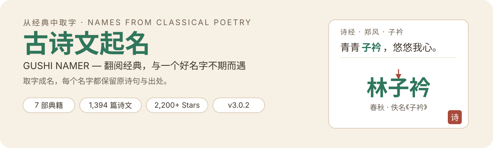
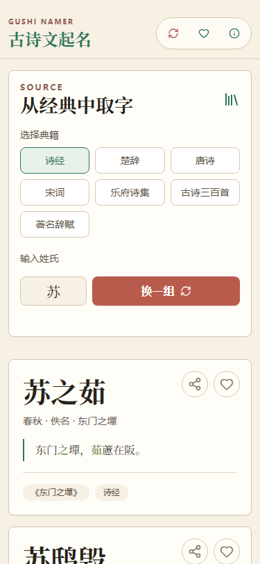

<p align="right"><a href="README.md">中文</a></p>

<p align="center">
  
</p>

<p align="center">
  <a href="https://gushi-namer.xiaosang.cc/">▶ Try Online</a>
  ·
  <a href="https://holynova.github.io/gushi_namer/">GitHub Pages Mirror</a>
  ·
  <a href="https://github.com/holynova/gushi_namer">GitHub Repository</a>
</p>

Gushi Namer generates Chinese baby names from 1,394 classical poems across 7 collections — the Book of Songs, Songs of Chu, Tang poetry, Song lyrics, and more. Pick a collection, enter a family name, and get 6 candidate names, each with its original verse and source. Save favorites locally, export them as JSON, or share a name card with verse and QR code. 2,200+ GitHub stars.

## Screenshots

<p align="center">
  
</p>

<p align="center">
  
</p>

## How It Works

1. **Pick a collection**: 诗经 Book of Songs (306), 楚辞 Songs of Chu (17), 唐诗 Tang poetry (320), 宋词 Song lyrics (222), 乐府诗集 Yuefu (203), 古诗三百首 300 Tang Poems (279), 著名辞赋 Famous Fu Prose (47).
2. **Enter a family name** and get 6 candidate names at once; switching collections refreshes immediately.
3. **Every name has a source**: open one to see the original verse, poem title, author, and dynasty, with the chosen characters highlighted.
4. **Inauspicious-character filter**: 68 common taboo characters (such as 凶, 丑, 病, 死) are automatically excluded before a name is shown.

## Features

- **Favorites**: tap the heart to save, stored in the current browser (localStorage), no login needed.
- **Import & export**: favorites can be exported as JSON for backup and imported to restore, so switching devices doesn't lose them.
- **Share cards**: generate a name card image in one tap, with the original verse, source, and a project QR code, ready to send to family.
- **Mobile-friendly**: the header collapses on scroll, keeping three shortcuts: 换一组 (new set), 收藏 (favorites), 关于 (about).
- **Demo video**: [40-second demo (MP4 · 1080p)](assets/demo-video.mp4), from picking a collection to favorites and sharing, with a recorded guqin soundtrack.

## Run Locally

```bash
git clone https://github.com/holynova/gushi_namer.git
cd gushi_namer
pnpm install
pnpm dev
```

Build:

```bash
pnpm build
```

## Tech

- React 19 + TypeScript + Vite 7, Tailwind CSS; `_legacy/` is the old webpack implementation, kept as an archive.
- The naming engine is `src/utils/namer.ts`: pick a poem at random, split it into lines, strip punctuation and taboo characters, then take two characters in order from one line to form a name.
- Poem data lives in `public/json/` (7 JSON files, 1,394 poems), loaded on demand; the poetry data comes from the web.
- Share cards are rendered with html-to-image, QR codes with qrcode.react.

```
src/App.tsx               Main UI: collection picker / family name input / 6 candidates / favorites page
src/components/           Collection picker, name input, name cards, favorites page, about page
src/utils/namer.ts        Naming core: pick poem → split lines → clean → take two characters
src/utils/favorites.ts   Favorites: localStorage access + JSON import/export
public/json/              7 collections of poem data (1,394 poems)
```

## Star History

[](https://www.star-history.com/#holynova/gushi_namer&Date)
