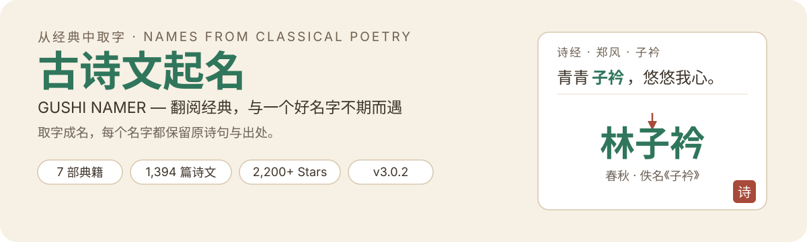
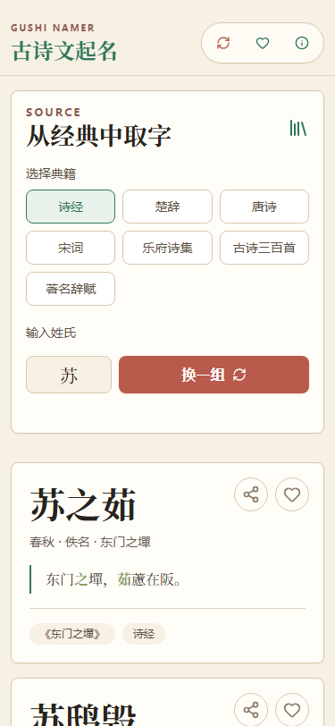

<p align="center">
  
</p>

<p align="center">
  <a href="https://gushi-namer.xiaosang.cc/">▶ 在线体验 Try Online</a>
  ·
  <a href="https://holynova.github.io/gushi_namer/">GitHub Pages 镜像</a>
  ·
  <a href="https://github.com/holynova/gushi_namer">GitHub 仓库</a>
</p>

古诗文起名从《诗经》《楚辞》、唐诗、宋词等 7 部典籍的 1,394 篇诗文中取字组合名字，并为每个名字保留原诗句与出处。选典籍、输入姓氏，一次生成 6 个候选名字；喜欢的可以收藏、导出，还能生成带诗句与二维码的分享卡片。GitHub 标星 2,200+。

Gushi Namer generates Chinese baby names from 1,394 classical poems across 7 collections — the Book of Songs, Songs of Chu, Tang poetry, Song lyrics, and more. Pick a collection, enter a family name, and get 6 candidate names, each with its original verse and source. Save favorites locally, export them as JSON, or share a name card with verse and QR code. 2,200+ GitHub stars.

## 截图 / Screenshots

<p align="center">
  
</p>

<p align="center">
  
</p>

## 怎么用 / How It Works

1. **选典籍**：诗经（306 篇）、楚辞（17 篇）、唐诗（320 篇）、宋词（222 篇）、乐府诗集（203 篇）、古诗三百首（279 篇）、著名辞赋（47 篇）。
2. **输入姓氏**，一次生成 6 个候选名字；切换典籍后立即刷新。
3. **每个名字都有出处**：点开看原诗句、篇名、作者与朝代，取字位置高亮标出。
4. **忌字过滤**：自动避开 68 个常见忌讳字（如凶、丑、病、死），生成的名字先过一遍筛。

## 功能 / Features

- **收藏**：点爱心收藏，存在当前浏览器（localStorage），无需登录。
- **导入导出**：收藏记录可导出 JSON 备份，也可导入恢复，换设备不丢。
- **分享卡片**：一键生成名字卡片图片，含原诗句、出处与项目二维码，可直接发给家人看。
- **移动端适配**：滚动时头部自动收起，保留换一组、收藏、关于三个快捷入口。
- **演示视频**：[40 秒演示（MP4 · 1080p）](assets/demo-video.mp4)，从选典籍到收藏与分享，配古琴实录。

## 本地运行 / Run Locally

```bash
git clone https://github.com/holynova/gushi_namer.git
cd gushi_namer
pnpm install
pnpm dev
```

构建：

```bash
pnpm build
```

## 技术 / Tech

- React 19 + TypeScript + Vite 7，Tailwind CSS；`_legacy/` 是旧版 webpack 实现，仅作存档。
- 起名逻辑在 `src/utils/namer.ts`：随机取一篇诗文、切分诗句、清洗标点与忌讳字、从句中按原序取两字成名。
- 诗文数据在 `public/json/`（7 个 JSON，1,394 篇），页面加载时按需取用；诗歌数据来源于网络。
- 分享卡片用 html-to-image 转图片、qrcode.react 生成二维码。

```
src/App.tsx               主界面：选典籍 / 输姓氏 / 6 个候选名字 / 收藏页
src/components/           典籍选择、姓氏输入、名字卡片、收藏页、关于页
src/utils/namer.ts        起名核心：取篇 → 切句 → 清洗 → 取两字
src/utils/favorites.ts   收藏：localStorage 存取 + JSON 导入导出
public/json/              7 部典籍数据（1,394 篇）
```

## Star History

[](https://www.star-history.com/#holynova/gushi_namer&Date)

## English

**Gushi Namer** turns classical Chinese poetry into baby names. It draws from 1,394 poems in 7 collections — Shijing (306), Chuci (17), Tang poetry (320), Song lyrics (222), Yuefu (203), 300 Tang poems (279), and famous fu prose (47) — and composes a two-character given name from a single verse, keeping the original line and its source attached to every name.

- **How it works**: choose a collection, enter a family name, and get 6 candidates at once. Switching collections refreshes immediately. A built-in filter removes 68 inauspicious characters before a name is shown.
- **Keep & share**: favorites live in the browser (localStorage, no login), export/import as JSON, and any name can be turned into a shareable card image with its verse, source, and a QR code.
- **Run it**: `pnpm install && pnpm dev` (build: `pnpm build`).
- **Tech**: React 19 + TypeScript + Vite 7 + Tailwind CSS. The naming engine is `src/utils/namer.ts`; poem data is 7 JSON files under `public/json/`.
